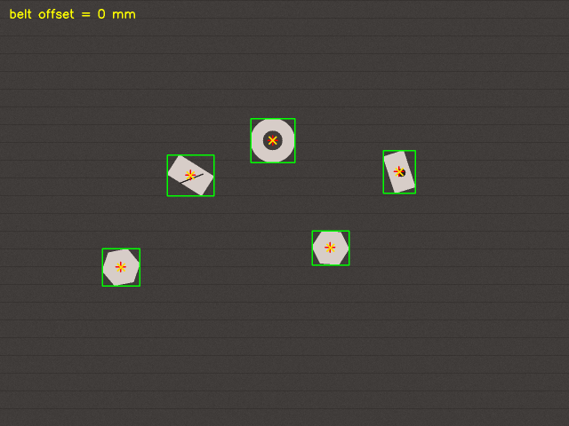
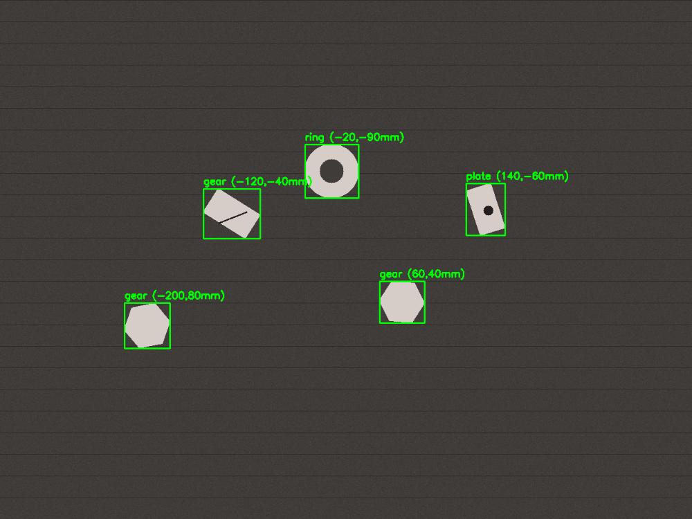
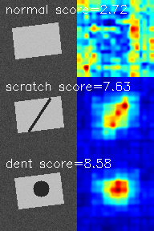

# 工业六轴机器人视觉引导动态分拣系统

> 面向产线「动态来料 → 视觉定位/质检 → 机器人分拣」场景的**视觉引导软件**。
> 算法与协议是真实实现，缺的硬件用**等价模拟件**替代，无真机也能端到端复现、可测试、可审查。



*上图：传送带持续前进，**红叉 = 编码器补偿后的抓取点**（跟随运动工件），**黄点 = 未补偿的触发位置**（原地滞留）——这就是简历里「看着准、抓不准」问题的可视化解法。*

## 一句话介绍（面试 30 秒版）

> 这是产线动态分拣的视觉引导工位：固定相机硬触发拍照 + 九点标定把像素映射到机器人基座系，
> 编码器锁存触发时刻计数值、抓取前用计数差补偿皮带位移；OpenCV/YOLO 定位 + PatchCore 检缺陷；
> 结果按 Modbus TCP 点表发给 PLC，MQTT 旁路镜像到数字孪生。我在桌面环境用模拟件把整条视觉链路
> 复现并跑通，定位/补偿误差 ~0.35mm，经典定位路径单帧 ~3ms。

## 它做了什么（含实测数字）

| 模块 | 说明 | 实测结果 |
| --- | --- | --- |
| 相机内参标定 | 张正友标定法（cv2.calibrateCamera） | fx 误差 ~0.07% |
| 九点标定 | 图像 ↔ 基座平面单应 + 残差评估 | 残差 ~0.2mm |
| 手眼标定 | AX=XB（Tsai-Lenz 两步法，先旋转后平移） | 与 OpenCV 交叉验证一致 |
| 工件定位 | OpenCV 轮廓/最小外接矩形 + YOLO 适配器 | 定位误差 <0.6mm |
| 表面缺陷检测 | PatchCore 无监督异常检测（torch）+ 统计兜底 | 缺陷样本异常分显著更高 |
| 传送带动态跟踪 | 编码器 pulses/mm 标定 + 触发锁存 + 计数差补偿 | 补偿后误差 **~0.35mm** |
| Modbus TCP 点表 | 视觉 Client ↔ 模拟 PLC Server | float32 字序/单位逐位校验 |
| MQTT 孪生旁路 | paho-mqtt + Three.js 可视化 | 只读镜像 |
| 单帧节拍 | 本机实测 300 次 | 经典路径 mean **~3ms** |

## 演示截图





*PatchCore 只用正常样本训练：正常件异常分 2.64，划痕 7.63、凹坑 8.59，阈值从正常样本校准。*

## 快速开始

```bash
# 1. 安装 uv（已装可跳过）: https://docs.astral.sh/uv/getting-started/installation/

# 2. 建环境 + 装核心依赖
uv sync --extra dev

# 3. 跑单元测试（19 个）
uv run pytest

# 4. 端到端演示（定位→标定映射→Modbus→传送带补偿→孪生）
uv run python scripts/run_demo.py

# 5. 单帧节压实测
uv run python scripts/benchmark.py

# 6. 缺陷检测（PatchCore，需 torch）
uv sync --extra dev --extra patchcore
uv run python scripts/defect_demo.py
```

> 国内网络可加清华镜像：`uv sync --extra dev --index-url https://pypi.tuna.tsinghua.edu.cn/simple`。

## 面试怎么讲（核心口径，面试前过一遍）

**会被深挖的 4 个点：**

1. **「传送带动态跟踪怎么做的？」**
   编码器 4 倍频 + 标定 pulses/mm；触发时锁存编码器值 C0，抓取时读 C1，
   位移 `d=(C1−C0)/pulses_per_mm`，乘皮带在基座系的方向向量补偿位置。
   本仓库演示里补偿后误差 ~0.35mm。

2. **「Modbus 传 float32 为什么容易出问题？」**
   一个 float32 占两个 16 位寄存器，谁在高位（字序）各家不一致；我们点表写死
   ABCD 字序 + 单位（mm/rad/pulse）+ 坐标系，换 PLC 直接复用点表。

3. **「数字孪生怎么保证不干扰产线？」**
   旁路只读镜像：只订阅结果、只写文件/MQTT，不往任何设备写字节；估算量打
   estimated 标记，页面上和实测值分开显示。

4. **「标定误差/定位精度是多少？」**
   内参 fx 误差 ~0.07%、九点残差 ~0.2mm、定位 <0.6mm、补偿后 ~0.35mm，
   都是「合成真值 + 加噪恢复」的口径，用于证明算法正确；真机精度需现场复测。

**数字口径（别踩红线）：**
- `~0.35mm` 是**定位/补偿误差**，不是产线抓取成功率；99% 成功率要有「连续作业时长/人工干预次数」口径才报。
- `~3ms` 是 **OpenCV 经典路径本机实测**；简历里「<80ms」指 YOLO+PatchCore 完整路径的**目标值**，口径说清楚。
- 相机图像是**合成渲染**，别说「真机取图已跑通」。详细边界见 [`docs/honesty.md`](docs/honesty.md)。

## 目录结构

```
src/sorting_vision/
├── calibration/      标定（内参 / 九点 / 手眼 AX=XB）
├── perception/       定位（OpenCV/YOLO）+ 缺陷检测（PatchCore）
├── conveyor/         编码器 pulses/mm 标定 + 动态跟踪
├── comms/            Modbus TCP 点表 + 模拟 PLC + MQTT 旁路
├── simulation/       相机/编码器/机器人/PLC 模拟件
└── twin/             孪生数据汇聚
scripts/              标定/演示/节压/缺陷/素材 入口
web/twin.html         Three.js 孪生可视化
docs/                 架构、点表、诚实口径
tests/                单元测试（19 个）
```

## 文档

- [`docs/architecture.md`](docs/architecture.md) —— 架构与数据流
- [`docs/point_table.md`](docs/point_table.md) —— Modbus TCP 点表（字序/单位/坐标系约定）
- [`docs/honesty.md`](docs/honesty.md) —— 真实 vs 仿真口径、数字口径（**面试前必看**）

## License

MIT
